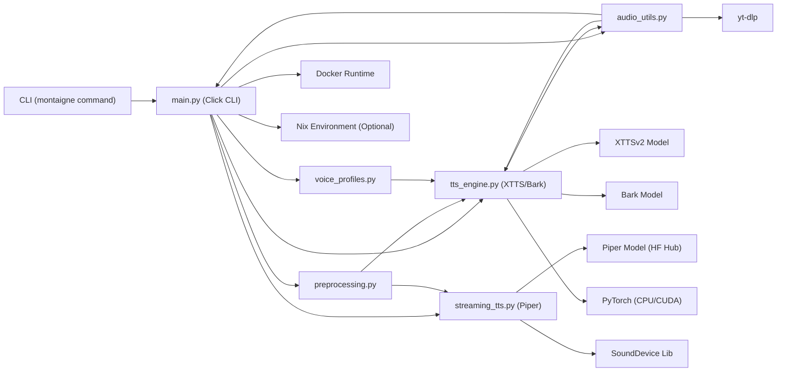
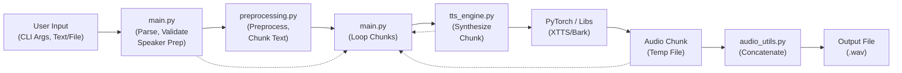
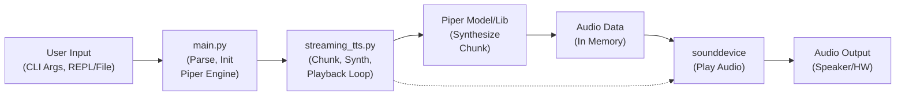

# Montaigne TTS

<!-- Badges -->
[](https://github.com/h0ffmann/montaigne/actions/workflows/docker-publish.yml)
[](https://github.com/h0ffmann/montaigne/actions/workflows/tts-tasks-ubuntu.yml)


# Montaigne TTS

Montaigne TTS is a command-line interface (CLI) tool designed for flexible Text-to-Speech (TTS) synthesis. It supports multiple TTS engines (XTTSv2, Bark, Piper), various speaker voice input methods (audio file, YouTube URL, predefined profiles), text preprocessing capabilities, and both batch and interactive/streaming synthesis modes. The project is containerized using Docker for ease of deployment and dependency management, with optional Nix support for development environments.

## Features

* **Multiple TTS Engines:**
  * **XTTSv2 (Coqui TTS):** High-quality, multilingual, voice-cloning TTS. (Batch mode)
  * **Bark (Suno AI):** Multilingual model capable of generating speech, music, and sound effects, often with more expressive or varied outputs. (Batch mode)
  * **Piper:** Fast, efficient, local TTS engine suitable for streaming/interactive use.
* **Flexible Speaker Input (XTTSv2):**
  * Use a local WAV file as a voice reference.
  * Provide a YouTube video URL (audio will be downloaded and used).
  * Select from predefined voice profiles (requires configuration and hosting).
* **Text Preprocessing:**
  * Handles custom tags for pauses (`[pause:0.5]`).
  * Adds emphasis via commas around text surrounded by `*` or `**`.
  * Basic text cleaning and normalization.
  * (Note: Tone tags `[tone]...[/tone]` are parsed but currently only logged, not affecting synthesis).
* **Synthesis Modes:**
  * **Batch (`synthesize`):** Process text from a string or file, outputting a single audio file. Handles long texts by chunking.
  * **Live/Streaming (`live`):** Interactive mode using Piper TTS for real-time synthesis and playback.
* **Containerization:** Dockerfile provided for building CUDA-enabled or CPU-only images, ensuring reproducibility.
* **Development Environment:** Optional Nix Flake for managing development dependencies. `justfile` provides common development tasks.
* **Workspace Structure:** Uses `uv` workspaces to manage the `montaigne` package and potentially other related tools (like `aider-analytics`).

## System Architecture

### 1. High-Level Overview

Montaigne acts as an orchestrator and interface for various underlying TTS technologies. The user interacts with the system via the `montaigne` CLI. The CLI parses commands and arguments, preprocesses the input text, selects and initializes the appropriate TTS engine, manages speaker voice data, performs synthesis (either in batches or streaming), handles audio post-processing (concatenation), and outputs the final audio to a file or plays it directly. Docker provides the runtime environment, managing complex dependencies like PyTorch, CUDA, and specific TTS libraries.



### 2. Component Interactions

- **User -> CLI (main.py)**: The user executes `montaigne synthesize ...` or `montaigne live ...`. Click handles argument parsing and validation.

- **main.py -> Input Handling**: Reads text from `--text` argument or `--text-file`. Validates mutually exclusive speaker inputs (`--speaker-wav`, `--speaker-youtube-id`, `--voice-profile`) for XTTS or `--speaker-prompt` for Bark.

- **main.py -> audio_utils.py / voice_profiles.py (Speaker Prep)**:
  - If `--speaker-youtube-id`, `audio_utils.download_audio_from_youtube` is called (using yt-dlp).
  - If `--voice-profile`, `voice_profiles.get_voice_profile` is called to potentially download the profile WAV.
  - The path to the final speaker WAV is determined.

- **main.py -> preprocessing.py**: Input text is passed to `preprocess_text_for_tts` for cleaning and tag processing, then to `chunk_text` to split long inputs for batch processing.

- **main.py -> Engine Selection & Initialization**:
  - Based on the `--engine` choice (xtts or bark) and `--cpu` flag, the appropriate engine (`XTTSv2Engine` or `BarkEngine`) is instantiated via `get_tts_engine` (from tts_engine.py). Models are loaded (potentially triggering downloads if not cached/provided).
  - For the `live` command, `PiperStreamingTTS` (from streaming_tts.py) is instantiated, potentially downloading the Piper model from Hugging Face Hub via `hf_hub_download`.

- **Synthesis Loop (synthesize command)**:
  - main.py iterates through processed text chunks.
  - For each chunk, `engine_instance.synthesize()` is called, passing the chunk, language, output path for the chunk, and engine-specific params (like speaker_wav).
  - tts_engine.py uses the underlying library (TTS or Bark) and PyTorch (CPU/GPU) to generate audio data.
  - The audio chunk is saved to a temporary file.

- **Streaming Loop (live command)**:
  - main.py reads input (from file or REPL).
  - Input is passed to `engine.stream_speak()` in streaming_tts.py.
  - `stream_speak` may further chunk the input (e.g., by sentence), synthesizes each small chunk using Piper (`_synthesize_chunk_to_temp`), and potentially plays it back immediately or after accumulating chunks (implementation detail - current code synthesizes chunks then concatenates before playing). It uses sounddevice for playback.

- **main.py -> audio_utils.py (Concatenation)**: After the batch synthesis loop, `concatenate_audio_files` is called to merge all temporary audio chunks into the final output file specified by `--output-file`. Temporary files are deleted.

- **Output**: The final WAV file is saved (synthesize) or audio is played directly (live).

### 3. Data Flow Diagrams

#### A. synthesize Command Flow:



#### B. live Command Flow:



### 4. Design Decisions and Rationale

- **CLI Interface (Click)**: Chosen for its ease of creating user-friendly command-line interfaces with argument parsing, validation, and help generation.

- **Modular Python Structure**: Code is separated into modules based on functionality (CLI, engines, utils, preprocessing) to improve maintainability and testability.

- **Engine Abstraction (BaseTTSEngine)**: While simple, it provides a basic structure for adding new batch TTS engines in the future.

- **Separate Streaming Engine (PiperStreamingTTS)**: Streaming has different requirements (low latency, chunked processing, audio playback integration) necessitating a distinct implementation. Piper was likely chosen for its speed and local execution capabilities suitable for streaming.

- **Workspace (uv)**: Allows managing the core montaigne library alongside potential future tools (like aider-analytics) within the same project structure and dependency management context.

- **Containerization (Docker)**: Essential for managing the complex and often conflicting dependencies of ML/TTS libraries (PyTorch, CUDA, system libraries). Provides a consistent runtime environment. Includes multi-stage builds to separate build tools and optimize image size, and handles model caching/injection.

- **Nix Flake (Optional)**: Offers a declarative and reproducible way to manage the development environment, pinning exact versions of Python, libraries, and system tools. Useful for developers contributing to the project.

- **Task Runner (justfile)**: Simplifies common development workflows (installation, linting, building, running, testing) into easy-to-remember commands. Delegates complex logic to shell scripts.

- **Speaker Input Flexibility**: Offering multiple ways to provide a voice reference (file, URL, profile) enhances usability for different scenarios. yt-dlp integration is a convenient feature.

- **Text Preprocessing**: Basic tag handling ([pause], *emphasis*) aims to give users some control over the synthesized speech rhythm and emphasis, although limited.

### 5. System Constraints and Limitations

- **Dependencies**: Requires significant dependencies (PyTorch, TTS models, CUDA toolkit if using GPU) leading to large installation sizes and potentially complex setup outside of Docker/Nix.

- **Hardware**: GPU (NVIDIA with CUDA) is highly recommended for acceptable performance with XTTSv2 and Bark. CPU synthesis can be very slow. Streaming mode requires audio playback capabilities (sounddevice and underlying OS libraries like ALSA/PulseAudio/CoreAudio).

- **Model Quality**: Output quality is inherently limited by the chosen TTS model (XTTSv2, Bark, Piper) and the quality/length/characteristics of the provided speaker reference audio (for XTTSv2).

- **Preprocessing**: The current text preprocessing is basic (regex-based). It doesn't perform complex Natural Language Processing (NLP) for tasks like automatic emphasis, intonation detection, or advanced punctuation handling. Tone tags are parsed but not implemented in synthesis.

- **Chunking**: Text chunking for batch mode is based on simple strategies (paragraphs, max length). It might split sentences awkwardly in some cases, potentially affecting the flow of the final concatenated audio.

- **Error Handling**: While present, error handling for external issues (network errors during downloads, invalid audio files, model loading failures) could be more granular and provide more user-friendly feedback.

- **Concurrency**: The application currently processes synthesis tasks sequentially.

- **Python Version**: Strictly requires Python 3.11 (>=3.11,<3.12).

- **Voice Profiles**: Requires manual setup and hosting of voice profile WAV files; the example URLs are placeholders.

## Installation

There are several ways to install and run Montaigne TTS:

### 1. Docker (Recommended)

This is the easiest way to get started, especially if you need GPU support. It ensures all dependencies are correctly installed.

**Prerequisites**: Docker, NVIDIA Container Toolkit (for GPU support).

**Build the image**:

```bash
# Build with GPU support (will download model if not found locally)
just docker_build

# Build with GPU support, using a local XTTS model if available
# (Assumes model files are in ~/.local/share/tts/...)
# This first copies the local model into ./model_files for the build context
just docker_dev

# Build for CPU only (add relevant build args if needed)
# Example: Force CPU build if Docker defaults to GPU otherwise
# (Check your Docker setup - often CPU is default if no GPU args)
# The runtime '--cpu' flag is separate from the build itself.
just docker_build # (Check Dockerfile for CPU-specific build logic if needed)
```

**Run**: See Usage section below for docker run commands.

### 2. Nix (Development)

If you have Nix installed with Flakes enabled, you can get a development shell with all dependencies.

**Prerequisites**: Nix (with Flakes enabled: `experimental-features = nix-command flakes`).

**Enter Development Shell & Install**:

```bash
# Update flake inputs and enter shell, then install packages
just nix_setup

# Or, enter the shell manually and install
nix develop --impure # Allow access to non-Nix resources if needed
just install_workspace
```

**Run**: Execute montaigne commands directly within the Nix shell.

### 3. Manual / Ubuntu (CPU Only Example)

This uses uv to create a virtual environment and install dependencies. Primarily for CPU usage. Requires Python 3.11 and uv installed.

**Prerequisites**: Python 3.11, uv, ffmpeg, libsndfile1, potentially others (see scripts/run_ubuntu_cpu_tasks.sh or Dockerfile for hints).

**Run the setup script**:

```bash
# This script creates a .venv, installs dependencies (CPU PyTorch),
# and runs sample TTS commands. Adapt as needed.
bash scripts/run_ubuntu_cpu_tasks.sh
```

**Activate venv**: `source .venv/bin/activate`

**Run**: `montaigne --cpu ...`

## Usage (CLI Commands)

The primary interface is the `montaigne` command.

**Common Options**:

- `--cpu`: Force CPU usage, even if CUDA is available.
- `-h, --help`: Show help message.

### montaigne synthesize [OPTIONS] (Batch Mode)

Synthesizes speech from text input (string or file) and saves it to an output audio file.

**Options**:

- `--engine [xtts|bark]` (Default: xtts)
- `--text TEXT`: Text to synthesize (if not using --text-file).
- `--text-file FILE`: Path to a text file to synthesize.
- `--language TEXT`: Language code (e.g., en, pt, es). Required.
- `--output-file FILE`: Path to save the output WAV file. Required.
- `--speed FLOAT`: Playback speed for XTTSv2 (Default: 1.0).

**XTTS Speaker Options** (Mutually Exclusive):
- `--speaker-wav FILE`: Path to a WAV file for voice cloning.
- `--speaker-youtube-id TEXT`: YouTube video ID for voice cloning.
- `--voice-profile TEXT`: Name of a predefined voice profile.

**Bark Speaker Option**:
- `--speaker-prompt TEXT`: Bark history prompt (e.g., en_speaker_1, zh_speaker_5). If omitted, Bark might use a default or generic prompt.

**Examples**:

```bash
# XTTS: Synthesize text using a speaker WAV file
montaigne synthesize \
  --text "Hello world, this is a test using a local speaker file." \
  --language en \
  --speaker-wav ./input/speaker.wav \
  --output-file ./output/xtts_local_speaker.wav

# XTTS: Synthesize text from a file using a YouTube video voice
montaigne synthesize \
  --text-file ./input/my_script.txt \
  --language en \
  --speaker-youtube-id "dQw4w9WgXcQ" \
  --output-file ./output/xtts_youtube_speaker.wav

# XTTS: Synthesize using a predefined voice profile (CPU forced)
montaigne synthesize \
  --text "Using a voice profile." \
  --language pt \
  --voice-profile "my-profile-name" \
  --output-file ./output/xtts_profile_cpu.wav \
  --cpu

# Bark: Synthesize text using a specific Bark speaker prompt
montaigne synthesize \
  --engine bark \
  --text "こんにちは、バークです。" \
  --language ja \
  --speaker-prompt "ja_speaker_2" \
  --output-file ./output/bark_japanese.wav

# --- Running via Docker ---

# Build the image first (e.g., `just docker_build`)
# Ensure input/output directories exist on the host: mkdir -p input output
# Place speaker.wav in ./input

# Docker: XTTS synthesis mapping local input/output dirs (GPU)
docker run --rm --gpus all \
  -v "$(pwd)/input:/app/input:ro" \
  -v "$(pwd)/output:/app/output:rw" \
  montaigne:latest \
  synthesize \
  --text "Synthesized inside a Docker container with GPU." \
  --language en \
  --speaker-wav /app/input/speaker.wav \
  --output-file /app/output/docker_gpu_xtts.wav

# Docker: Bark synthesis mapping local input/output dirs (CPU)
docker run --rm \
  -v "$(pwd)/input:/app/input:ro" \
  -v "$(pwd)/output:/app/output:rw" \
  montaigne:latest \
  synthesize \
  --engine bark \
  --text "Bark synthesis in Docker using CPU." \
  --language en \
  --output-file /app/output/docker_cpu_bark.wav \
  --cpu # Add --cpu flag inside the container command
```

### montaigne live [OPTIONS] (Interactive/Streaming Mode)

Starts an interactive TTS session using Piper TTS. Reads input from stdin (REPL) or a file and plays back synthesized audio.

**Options**:

- `--piper-voice TEXT`: Name of the Piper voice model to use (e.g., en_US-amy-low). Default: en_US-amy-low. Models are downloaded from Hugging Face Hub (rhasspy/piper-voices).
- `--file FILE`: Read text input from a file instead of the interactive prompt.
- `--output-dir PATH`: Directory to save the generated audio segments (Default: ./output).
- `--cpu`: Force CPU usage.

**Examples**:

```bash
# Start interactive live session with default English voice
montaigne live

# Start live session using a German voice
montaigne live --piper-voice de_DE-thorsten-medium

# Process text from a file and speak it using Piper (CPU forced)
montaigne live --file ./input/my_script.txt --output-dir ./live_audio_output --cpu
```

## API Documentation (CLI Options)

The primary API for Montaigne TTS is its command-line interface detailed in the Usage section. Below is a more structured breakdown of the options for each command.

### synthesize Command API

**Endpoint**: `montaigne synthesize`

**Method**: Command Line Execution

**Input Arguments**:

| Option | Type | Required | Default | Description |
|--------|------|----------|---------|-------------|
| `--engine` | [xtts\|bark] | No | xtts | Selects the TTS engine to use for synthesis. |
| `--text` | TEXT | Conditional¹ | - | The text string to synthesize. |
| `--text-file` | FILE (Path) | Conditional¹ | - | Path to a text file containing the text to synthesize. |
| `--language` | TEXT | Yes | - | Language code for the synthesis (e.g., en, pt, es). |
| `--output-file` | FILE (Path) | Yes | - | Path where the resulting WAV audio file will be saved. |
| `--cpu` | Flag | No | False | Force the use of CPU even if a CUDA-compatible GPU is detected. |
| `--speed` | FLOAT | No | 1.0 | (XTTS Only) Controls the speed of the synthesized speech. |
| `--speaker-wav` | FILE (Path) | Conditional² | - | (XTTS Only) Path to a local WAV file to use for voice cloning. |
| `--speaker-youtube-id` | TEXT | Conditional² | - | (XTTS Only) YouTube video ID whose audio will be used for voice cloning. |
| `--voice-profile` | TEXT | Conditional² | - | (XTTS Only) Name of a configured, predefined voice profile to use. |
| `--speaker-prompt` | TEXT | No | - | (Bark Only) History prompt name for selecting speaker/style (e.g., en_speaker_0). |

¹: Either `--text` or `--text-file` must be provided.
²: For `--engine xtts`, exactly one of `--speaker-wav`, `--speaker-youtube-id`, or `--voice-profile` must be provided. These are mutually exclusive. Not used for `--engine bark`.

**Output**:

- A WAV audio file saved to the path specified by `--output-file`.
- Console logs indicating progress, warnings, and errors.

**Usage Example**:

```bash
montaigne synthesize --engine xtts --text "API example for synthesis." --language en --speaker-wav ./input/speaker.wav --output-file ./output/api_example.wav
```

**Constraints**:

- Requires appropriate TTS models to be available (either downloaded automatically or provided locally in Docker context).
- Speaker options are engine-specific and mutually exclusive for XTTS.
- Performance heavily depends on hardware (CPU/GPU) and text length.

### live Command API

**Endpoint**: `montaigne live`

**Method**: Command Line Execution

**Input Arguments**:

| Option | Type | Required | Default | Description |
|--------|------|----------|---------|-------------|
| `--piper-voice` | TEXT | No | en_US-amy-low | Name of the Piper voice model to download/use from Hugging Face Hub (rhasspy/piper-voices). |
| `--file` | FILE (Path) | No | - | Path to a text file to read input from (otherwise uses interactive REPL). |
| `--output-dir` | PATH | No | ./output | Directory where generated audio segments for the session will be saved. |
| `--cpu` | Flag | No | False | Force the use of CPU for Piper synthesis. |

**Input (Runtime)**:

- If `--file` is not used: Text entered line-by-line at the interactive prompt (`>`).
- If `--file` is used: Reads text content from the specified file.

**Output**:

- Synthesized audio played directly through the system's default audio output device.
- Audio segments saved as WAV files within the specified `--output-dir`.
- Console logs.

**Usage Example**:

```bash
montaigne live --piper-voice fr_FR-siwis-medium --output-dir ./live_french_output
```

**Constraints**:

- Requires sounddevice library and its system dependencies (e.g., libportaudio2, ALSA/PulseAudio libs on Linux) to be installed correctly for audio playback.
- Requires internet access to download Piper models from Hugging Face Hub on first use (or if not cached).
- Audio quality is dependent on the chosen Piper voice model.

## Development

**Environment**: Use Nix (`just nix_setup` or `nix develop --impure`) or Docker for a consistent environment.

**Tasks**: The justfile provides common tasks:

- `just install_workspace`: Install/update Python packages using uv.
- `just check`: Run linters (ruff check) and formatters (ruff format --check).
- `just format`: Apply formatting (ruff format).
- `just test`: Run tests using pytest (ensure tests are written in packages/montaigne/tests/).
- `just clean`: Remove build artifacts and caches.
- `just docker_build`: Build the Docker image.
- `just docker_dev`: Build Docker image using local models.
- `just docker_run`: Run a test synthesis inside Docker.
- `just docker_run_gpu`: Run a command inside Docker with GPU access.

**Dependencies**: Managed via pyproject.toml (for Python packages using uv) and flake.nix (for Nix environment).

## Contributing

Contributions are welcome! Please follow standard Git workflow (fork, branch, pull request). Ensure code is formatted (`just format`) and passes checks (`just check`).

## License

(Specify License - e.g., MIT License, Apache 2.0). Currently not specified in the project files. Assuming a standard open-source license like MIT unless otherwise stated.
